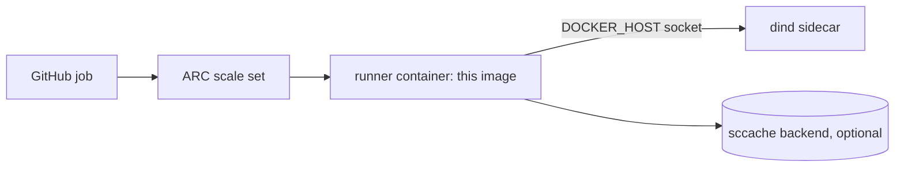

# ARC Rust runner

Use this image as the GitHub Actions runner for Rust repos on actions-runner-controller (ARC).
It is the official `actions-runner` image plus the tools Rust CI used to install in every job.



## What is installed

| Component | Purpose |
| --- | --- |
| `ghcr.io/actions/actions-runner` base | Runner, Docker CLI and buildx, git, curl, jq, sudo |
| build-essential, cmake, pkg-config, protoc with the protobuf well-known types | Native crates and build-time proto compilation |
| Rust (rustup, clippy, rustfmt) | The toolchain in `rust-toolchain.toml` of the Rust repos |
| sccache | Rust compile cache. Not turned on by default; set `RUSTC_WRAPPER=sccache` in the job. |

The image supports `linux/amd64` and runs as user `runner` (1001).
Rust lives in `/home/runner/.rustup` and `/home/runner/.cargo`, writable by the runner.
A repo that pins a different toolchain still works: rustup downloads it in that job.
See [Dockerfile](Dockerfile) for exact versions.

## Build and test

Run these commands from the repository root:

```sh
docker build --platform linux/amd64 -t arc-runner-rust:local images/arc-runner-rust
bash images/arc-runner-rust/scripts/test-image.sh arc-runner-rust:local
```

The test runs with no network as the runner user. It checks every tool, builds a small crate through sccache, and checks that the baked toolchain needs no download.
It also checks the runner externals that ARC's init container copies out.
It does not register with GitHub or talk to a Docker daemon.

## Storage and secrets

None in the image. The ARC scale-set values give the runner its GitHub token, its work volume and the Docker socket.
Deployment lives in `my-apps/development/arc-runners` of mitchross/talos-argocd-proxmox.

## Updates and rollback

Renovate opens PRs for the base image digest, rustup, Rust and sccache.
On a sccache PR (always its own PR), copy the new SHA256 from the release's `sccache-v<version>-x86_64-unknown-linux-musl.tar.gz.sha256` asset into `SCCACHE_SHA256`. The build fails until it matches.
Bump `RUST_VERSION` together with `rust-toolchain.toml` in the Rust repos, or those jobs download their own toolchain.
Every push publishes a `sha-` tag; `main` also moves `ghcr.io/mitchross/arc-runner-rust:main`. Pin the scale set by digest. Roll back by pinning the previous digest.

## Limits

- About 1.5-2 GB, pulled once per node.
- One Rust toolchain baked in. Others download per job.
