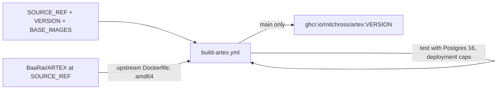

# ARTEX image

Run [ARTEX](https://github.com/BaaRai/ARTEX), an AGPL-3.0 security testing agent platform (Go server, Next.js UI, recon tools).
This image builds upstream's own `Dockerfile` at a pinned release commit. It adds no code and patches no file.
The build swaps each mutable `FROM` tag for the `tag@digest` in `BASE_IMAGES` (buildx `--build-context`).

Upstream publishes release binaries but no image: its Docker Hub job is off and `ghcr.io/baarai/artex` does not exist.



Find deployment manifests in [talos-argocd-proxmox](https://github.com/mitchross/talos-argocd-proxmox/tree/main/my-apps/development/artex).

## Version pins

| File | Content |
| --- | --- |
| `SOURCE_REF` | Full 40-character commit that upstream tag `v<VERSION>` points at |
| `VERSION` | Upstream release without the `v`, e.g. `0.7.0`. It is also the image tag. |
| `BASE_IMAGES` | One `image:tag@sha256:<digest>` per external image the upstream `Dockerfile` names |

The workflow checks that `v<VERSION>` (an annotated tag, compared through `^{}`) points at `SOURCE_REF`.
`scripts/artex-base-contexts.sh` fails the build unless `BASE_IMAGES` lists exactly the images upstream's `FROM` and `--from=` lines name.
It builds with `ARTEX_VERSION=v<VERSION>`, as upstream's release job does, so the server logs `"version":"v<VERSION>"`.
It never overwrites an existing tag, so a rebuild of the same release is not possible without a new tag scheme.
A `BASE_IMAGES` digest bump is built and tested, but only ships with the next `VERSION`.

## Build and test

`.github/workflows/build-artex.yml` runs on changes under `images/artex/`, the two `scripts/*artex*.sh` files or the workflow.
Every run builds once, tags the result `ghcr.io/mitchross/artex:<VERSION>`, loads it and runs the smoke test on it.
Pull requests stop there. A push to `main` logs in to GHCR first, then:

- pushes that same tested image, checks the registry digest matches, and writes `tag@digest` to the run summary;
- skips the push if the tag already exists and reports the existing digest;
- fails if the registry check errors for any reason other than "not found" (auth, network, rate limit).

Local build and test, from a checkout of upstream at `SOURCE_REF` and this repository:

```sh
contexts=(); while read -r c; do contexts+=(--build-context "$c"); done \
  < <(bash scripts/artex-base-contexts.sh /path/to/ARTEX/Dockerfile images/artex/BASE_IMAGES)
docker buildx build --load --platform linux/amd64 "${contexts[@]}" \
  --build-arg ARTEX_VERSION=v0.7.0 -t artex:local /path/to/ARTEX
bash scripts/test-artex.sh artex:local 0.7.0
```

`scripts/test-artex.sh` starts Postgres 16 (upstream CI's major) and ARTEX the way the talos Deployment does:
root server, all capabilities dropped except `CHOWN DAC_OVERRIDE FOWNER FSETID KILL SETGID SETUID`, no-new-privileges,
`-addr :8787 -proxy 127.0.0.1:8788 -exec-uid 10001 -exec-gid 10001`. It checks:

- `/api/ready` (Postgres ping) and `/api/health` answer;
- the startup config line shows the version, the loopback proxy, `quiet` noise and `/app/keys`;
- the recording proxy does not answer on the container address;
- `/app/data/exec-home` is `10001:10001 700` and `/app/keys/secret.key` is root `600`;
- a command through the drop shim runs as 10001 and cannot read `secret.key`;
- the server is ready again after a restart.

It does not call a model or run a task.

## Runtime contract

| Setting | Requirement |
| --- | --- |
| User | Root server. Agent processes (Bash, shell, custom tools, stdio MCP) drop to 10001:10001. Pass `-exec-uid 10001 -exec-gid 10001` so a failed drop stops the start instead of running agents as root. |
| Capabilities | `CHOWN DAC_OVERRIDE FOWNER FSETID KILL SETGID SETUID`. No `fsGroup`: the server sets owners itself. |
| Ports | `8787` UI and API (`GET /api/ready`, `GET /api/health`). `8788` is the traffic recording proxy; the image's default `CMD` binds it on all addresses, so override it with `-proxy 127.0.0.1:8788`. |
| Storage | `/app/data` (tasks, transcripts, traffic, executor home) and `/app/keys` (`jwt.key`, `secret.key`; set `ARTEX_JWT_KEY_DIR=/app/keys`). Keep `/tmp` from the image: ARTEX checks the sticky bit on its temp directories. |
| Database | Postgres via `ARTEX_PG_DSN`. Upstream tests on Postgres 16. |
| Secrets | `ARTEX_PG_DSN`. Model keys only for paid providers. `secret.key` encrypts stored secrets; losing it loses them. |
| Model | `ARTEX_LLM_PROVIDER=ollama` is keyless OpenAI Chat Completions to `ARTEX_LLM_BASE_URL`; it needs no Ollama daemon. |
| First run | The log prints a one-time setup token for `/setup`. |

## Update

1. Renovate proposes the new release in `VERSION`.
2. Set `SOURCE_REF` to the commit of `v<VERSION>`: `git ls-remote https://github.com/BaaRai/ARTEX.git 'refs/tags/v<VERSION>^{}'`.
   If the new `Dockerfile` names different base images, update `BASE_IMAGES` to match (the build fails until it does).
   If upstream now pins its `FROM` lines by digest itself, drop the overrides instead.
3. Read upstream's release notes for database and flag changes, then wait for the build and test.
4. After the owner merges, copy the digest from the `main` run summary into the talos deployment.

## Known limits

- `linux/amd64` only.
- Upstream's `Dockerfile` at `v0.7.0` names its four base images by tag only; `BASE_IMAGES` pins them. Its later commits pin by digest.
- The final stage still installs Playwright, BBOT and recon tools from the network, so a rebuild of the same commit can differ.
- The "not found" branch of the tag check is unproven until the first `main` run creates the package.
- The publish job needs write access to the `ghcr.io/mitchross/artex` package. A new package is private; make it public or give the cluster a pull secret before deploying.
