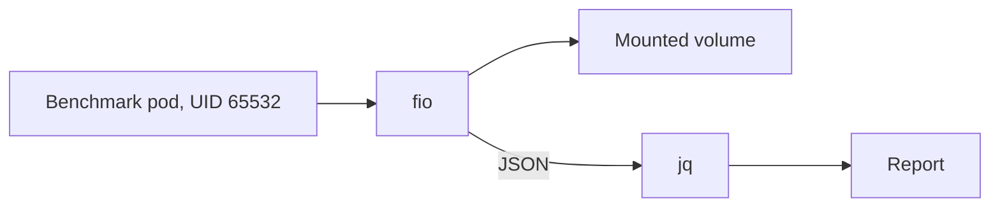

# fio

`ghcr.io/mitchross/fio`: pinned `fio` for storage benchmark pods, with `jq` for parsing its JSON output.
bash, coreutils, findutils and util-linux come from the Debian base. Nothing else is installed.
Deployment manifests live in [talos-argocd-proxmox](https://github.com/mitchross/talos-argocd-proxmox/tree/main/docs).



## Build and test

Run these commands from the repository root:

```sh
docker build --platform linux/amd64 -t fio:local images/fio
bash scripts/test-fio.sh fio:local
```

The test runs as UID 65532 with a read-only root filesystem and an empty `/tmp`.
It prints `fio --version` and runs a 4 MiB random-write job, then checks that `jq` parses the JSON result.

The workflow builds and tests before publishing an immutable `sha-<commit>-<run>-<attempt>` tag.
On `main` it also moves the `main` tag. Copy the digest from the job summary for deployment review.

## Runtime contract

| Setting | Requirement |
| --- | --- |
| User | UID/GID 65532. Set `runAsUser: 65532` and `fsGroup: 65532` so the test volume is writable. |
| Storage | Point `--directory` or `--filename` at the volume under test. `/tmp` is the default working directory. |
| Secrets | None. |
| Default command | `fio --version`. Pods set their own command. |

## Update

Base image digest is proposed by Renovate. Update `FIO_VERSION` and `JQ_VERSION` by hand from
[packages.debian.org](https://packages.debian.org/trixie/fio); Debian replaces superseded security builds.
Rebuild and run the test.

## Limits

- Linux amd64 only.
- No `libaio`/`io_uring` tuning is included beyond what Debian's `fio` build provides. Container runtime seccomp can block `io_uring`; use `--ioengine=libaio` or `psync` if it does.
- `--direct=1` depends on the filesystem under test; the smoke test uses buffered I/O.
