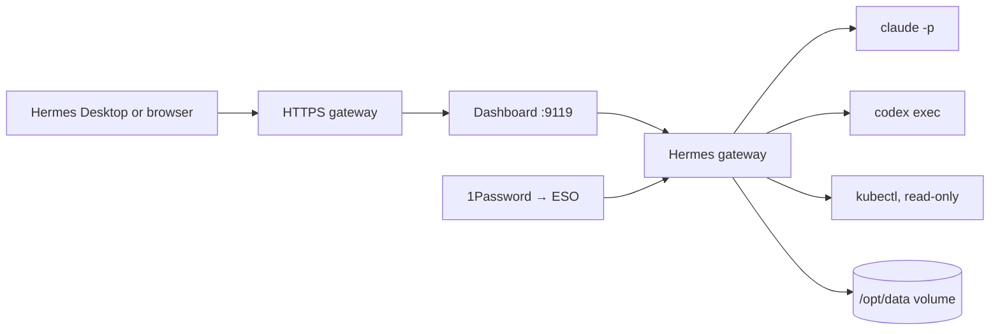

# Hermes agent image

Use this image to run Hermes Agent in your Kubernetes cluster with the coding agents and cluster CLIs its skills call.
The image contains tools. The `/opt/data` volume contains config, sessions, skills, memories and provider logins.



## What is installed

| Component | Purpose |
| --- | --- |
| Official Hermes Agent base | Gateway, dashboard, s6 supervision, Node 26, Python |
| Claude Code, Codex | Coding agents that Hermes drives through its `claude-code` and `codex` skills |
| kubectl, omnictl, talosctl, GitHub CLI, git, tmux, jq, ssh | Cluster and Omni checks, pull requests, interactive agent sessions |
| Rust (rustup, clippy, rustfmt), Go, build-essential, pkg-config, OpenSSL headers, protoc | Build and test the owner's Rust, Go, Node and Python repos; Node and Python come with the base |

The image supports `linux/amd64`. The container starts as root; s6-overlay drops the gateway and dashboard to user `hermes` (10000:10000).
Claude auto-updates are disabled. Update the CLIs through a new image build.
See [Dockerfile](Dockerfile) for exact versions.

## Build and test

Run these commands from the repository root:

```sh
docker build --platform linux/amd64 -t hermes-dev:local images/hermes-dev
bash scripts/test-hermes.sh hermes-dev:local
```

The test runs the smoke script as the `hermes` user with an empty data volume, then boots the container once and checks the Hermes version.
It does not test provider logins or cluster permissions.

## Storage and secrets

| Need | Where |
| --- | --- |
| `/opt/data` | Persistent volume. Everything Hermes writes lives here. |
| `CLAUDE_CODE_OAUTH_TOKEN` | Environment. From `claude setup-token` on a workstation, stored in 1Password. Gives `claude -p` your Claude subscription. |
| Codex login | Run `codex login --device-auth` once inside the container. The login stays in `/opt/data/.codex`. |
| Dashboard login | `HERMES_DASHBOARD_BASIC_AUTH_USERNAME`, `_PASSWORD`, `_SECRET` in the environment. |
| Model | `OPENAI_BASE_URL` style custom endpoint or `config.yaml` on the volume. |

Deployment manifests live in `my-apps/development/hermes` of mitchross/talos-argocd-proxmox.

## Updates and rollback

Renovate opens pull requests for the base image digest, the npm CLIs, `gh`, Go and the Rust toolchain. The build checks every download against the release's published checksums.
`omnictl`, `talosctl` and `kubectl` arrive as one "cluster CLIs" PR. Merge it only after the Omni server, Talos and Kubernetes run those versions.
Every push to `main` publishes `ghcr.io/mitchross/hermes-dev:main` and a `sha-` tag. Pin the deployment by digest. Roll back by pinning the previous digest.

## Limits

- No Docker or image builds, no Android SDK, no Xcode. iOS and Expo native builds need the Mac.
- No Pi, no browser. Paseo's image covers interactive development; this one covers Hermes-driven automation.
- `kubectl`, `omnictl` and `talosctl` have no credentials in the image. The cluster deployment mounts a read-only kubeconfig and an Omni service-account key.
