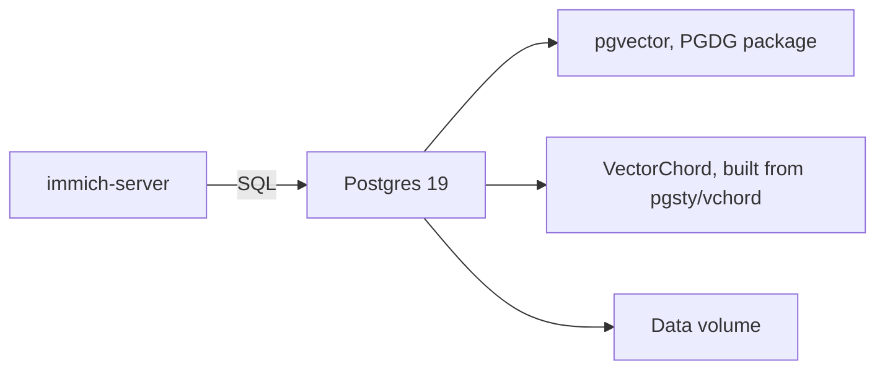

# immich-postgres

`ghcr.io/mitchross/immich-postgres`: Postgres 19 with pgvector and VectorChord, for Immich.
Immich's own image, `ghcr.io/immich-app/postgres`, stops at Postgres 18. This image fills the gap until it ships 19.
Deployment manifests live in [talos-argocd-proxmox](https://github.com/mitchross/talos-argocd-proxmox/tree/main/my-apps/media/immich).



## Build and test

Run these commands from the repository root:

```sh
docker build --platform linux/amd64 -t immich-postgres:local images/immich-postgres
bash scripts/test-immich-postgres.sh immich-postgres:local
```

The build compiles VectorChord with Rust and takes about three minutes.
The test runs as UID 999 with an empty data volume. It creates the `vchord` extension, builds a `vchordrq` index with the options Immich uses, and runs a nearest-neighbour query.

The workflow builds and tests before publishing an immutable `sha-<commit>-<run>-<attempt>` tag.
On `main` it also moves the `main` tag. Copy the digest from the job summary for deployment review.

## Runtime contract

| Setting | Requirement |
| --- | --- |
| User | UID/GID 999. Set `runAsUser: 999` and `fsGroup: 999`. |
| Storage | Mount the data volume at `/var/lib/postgresql`. `PGDATA` is `/var/lib/postgresql/19/docker`. |
| Secrets | `POSTGRES_USER`, `POSTGRES_PASSWORD` and `POSTGRES_DB`, read on the first start of an empty volume. |
| Default command | `postgres -c shared_preload_libraries=vchord.so`. Keep that flag if you override the command. |

This image does not include Immich's entrypoint, tuning files or health check. Pass tuning as `-c` flags.
A database copied from another server needs `ALTER DATABASE <db> SET vchordrq.probes = 1`; a dump does not carry database settings.

## Update

| Pin | Source |
| --- | --- |
| `postgres` base tag and digest | Renovate |
| `VCHORD_COMMIT` | A release tag of [pgsty/vchord](https://github.com/pgsty/vchord/releases). Immich accepts VectorChord `>=0.3 <2`. |
| `PGVECTOR_VERSION` | `apt-cache madison postgresql-19-pgvector` in the base image |
| `RUST_VERSION` | Any stable release that builds the pinned VectorChord commit |

Rebuild and run the test after each change.

## Switch back to upstream

Replace this image with `ghcr.io/immich-app/postgres` when it publishes a `19-vectorchord<version>` tag.
The data directory layout is the same, so the switch is an image change in talos. Then archive this directory.

## Limits

- Linux amd64 only.
- VectorChord comes from the pgsty fork. The fork does not list Postgres 19 in its release matrix yet; this build is a source build.
- A Postgres major upgrade needs a dump and restore. This image holds one major version.
