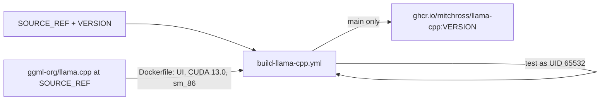

# llama.cpp CUDA image

Run mainline [llama.cpp](https://github.com/ggml-org/llama.cpp) `llama-server` on RTX 3090 (sm_86) nodes.
This image builds upstream at a pinned release tag. It adds no code of its own.

It exists because the official `ghcr.io/ggml-org/llama.cpp:server-cuda` images lag behind the Inkling 2 Mini fix
([#32704](https://github.com/ggml-org/llama.cpp/pull/32704)). Without it, `inkling2_loop` models produce gibberish.
The workflow refuses any `SOURCE_REF` that does not contain that commit.



Find deployment manifests in [talos-argocd-proxmox](https://github.com/mitchross/talos-argocd-proxmox/tree/main/my-apps/ai).

## What differs from upstream's `server-cuda`

- CUDA 13.0.3 (same major as `images/strata`, so the same node driver runs both), sm_86 only. The build fails if
  `libggml-cuda.so` holds code for any other architecture.
- The chat UI is built from source with `-DLLAMA_USE_PREBUILT_UI=OFF`, so the build downloads no prebuilt assets.
- Runs as UID/GID 65532. Ships `llama-server` (entrypoint), `llama-cli` and `llama-bench`.
- CPU backends load at runtime (`GGML_BACKEND_DL`, `GGML_CPU_ALL_VARIANTS`), so no runner CPU flags are baked in.

## Version pins

| File | Content |
| --- | --- |
| `SOURCE_REF` | Full 40-character commit of the upstream tag |
| `VERSION` | Image tag: `b<build>-sm86`, e.g. `b12611-sm86` |

The workflow checks that tag `b<build>` points at `SOURCE_REF` and that it contains #32704.
It never overwrites an existing tag, so a rebuild needs a new `VERSION`.

## Build and test

The workflow `.github/workflows/build-llama-cpp.yml` runs on changes under `images/llama-cpp/`.
Pull requests build and test the image but do not push. A push to `main` publishes `ghcr.io/mitchross/llama-cpp:<VERSION>`.

Local build and test, from the repository root:

```sh
docker build --platform linux/amd64 -t llama-cpp:local \
  --build-arg LLAMA_COMMIT="$(<images/llama-cpp/SOURCE_REF)" --build-arg LLAMA_BUILD_NUMBER=12611 images/llama-cpp
bash scripts/test-llama-cpp.sh llama-cpp:local 12611
```

The test runs as UID 65532 with a read-only root and an empty home. CI has no GPU, so it checks `--version`,
`--list-devices` (CPU only), `llama-bench` and `llama-cli`, and that `libggml-cuda.so` resolves every library except
the driver's `libcuda.so.1`. On a GPU node, `llama-server --list-devices` should list both 3090s.

## Runtime contract

| Setting | Requirement |
| --- | --- |
| User | UID/GID 65532. Set `fsGroup: 65532` if the server writes to the model volume. |
| Storage | Mount GGUF files read-only, e.g. at `/models`. `HOME=/home/llama` holds the download cache (`~/.cache/llama.cpp`) if `-hf` is used; mount an empty volume there. |
| Secrets | None. `HF_TOKEN` only if pulling gated models with `-hf`. |
| GPU | NVIDIA driver for CUDA 13.0 (580+) and the NVIDIA container runtime. |
| Port | 8080, `GET /health`. `LLAMA_ARG_*` env vars set any server flag. |

## Update

1. Pick a release tag `b<N>` and get its commit: `gh api repos/ggml-org/llama.cpp/git/ref/tags/b<N> --jq .object.sha`.
2. Set `SOURCE_REF` to that commit and `VERSION` to `b<N>-sm86`. Renovate proposes the tag on approval.
3. Open a PR here and wait for the build.
4. After the owner merges, copy the digest from the `main` run summary into the talos deployment.

CUDA and Node base digests are proposed by Renovate.

## Known limits

- `linux/amd64`, sm_86 only. Other GPUs need another `CMAKE_CUDA_ARCHITECTURES` and tag suffix.
- CI cannot run a GPU. Inference and the Inkling 2 Mini fix are checked on the cluster, not here.
- The build takes about an hour on a hosted runner.
- The publish job needs write access to the `ghcr.io/mitchross/llama-cpp` package.
