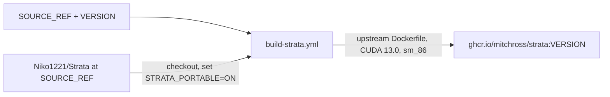

# Strata CUDA image

Run [Strata](https://github.com/Niko1221/Strata), a llama.cpp-based LLM server with MTP speculative decoding, on RTX 3090 (sm_86) nodes.
This image builds upstream Strata at a pinned commit. It adds no code of its own.



Find deployment manifests in [talos-argocd-proxmox](https://github.com/mitchross/talos-argocd-proxmox/tree/main/my-apps/ai/strata).

## What differs from upstream

- `CUDA_ARCHITECTURES=86` and `BUILD_VISION=0`: Ampere only, no vision encoder.
- `-DSTRATA_PORTABLE=ON`, patched into upstream's Dockerfile at build time. Upstream's default uses `-march=native`, which would bake the CI runner's CPU into the binary. The GPU node is a Zen+ Threadripper (AVX2, no AVX-512).

## Version pins

| File | Content |
| --- | --- |
| `SOURCE_REF` | Full 40-character upstream commit |
| `VERSION` | Image tag: `<strata version>.<patch>-<first 7 of SOURCE_REF>-sm86` |

The workflow checks that `VERSION` matches `SOURCE_REF` and upstream's `CMakeLists.txt` version.
It never overwrites an existing tag.

## Build

The workflow `.github/workflows/build-strata.yml` runs on changes under `images/strata/`.
Pull requests from this repo build the image but do not push. A push to `main` publishes `ghcr.io/mitchross/strata:<VERSION>`.
The build takes up to a few hours on a hosted runner. There is no runtime test; deployment review is the check.

Local build, from a checkout of upstream at `SOURCE_REF` with the `STRATA_PORTABLE` patch applied:

```sh
docker build --platform linux/amd64 --build-arg CUDA_ARCHITECTURES=86 --build-arg BUILD_VISION=0 -t strata:local .
```

## Runtime storage and secrets

The image needs no secrets. Model files and the pack cache live on a volume the deployment mounts.

## Update

1. Set `SOURCE_REF` to the new upstream commit and `VERSION` to match.
2. Open a PR here and wait for the build.
3. After the owner merges, copy the digest from the `main` run summary into the talos deployment.

## Known limits

- `linux/amd64`, sm_86 only. Other GPUs need a different `CUDA_ARCHITECTURES` and tag suffix.
- The publish job needs write access to the `ghcr.io/mitchross/strata` package. If the package links to another repo, grant this repo access in the package settings.
